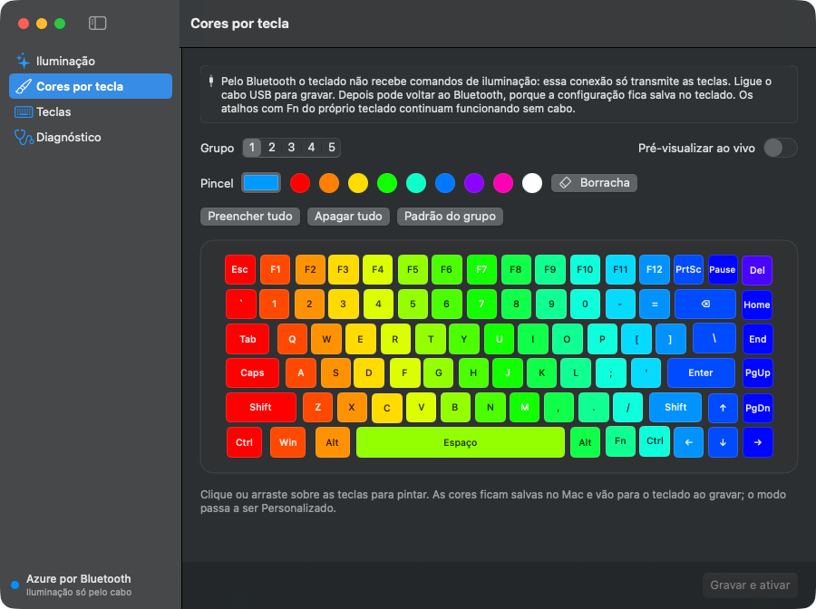
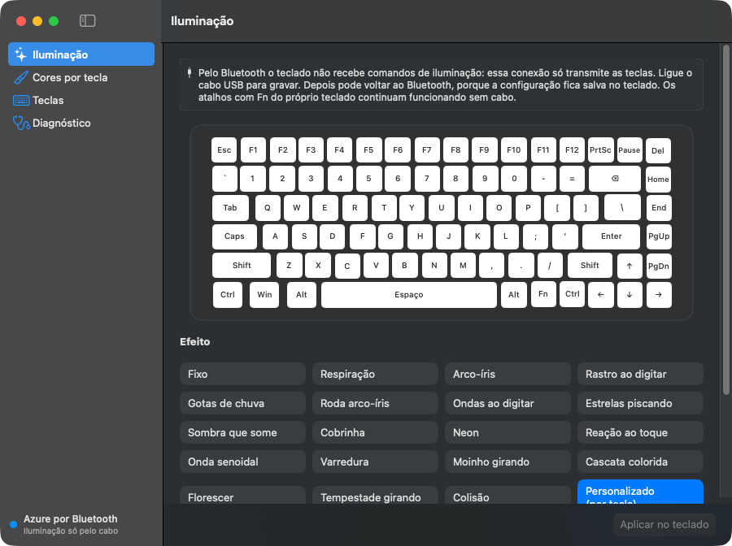
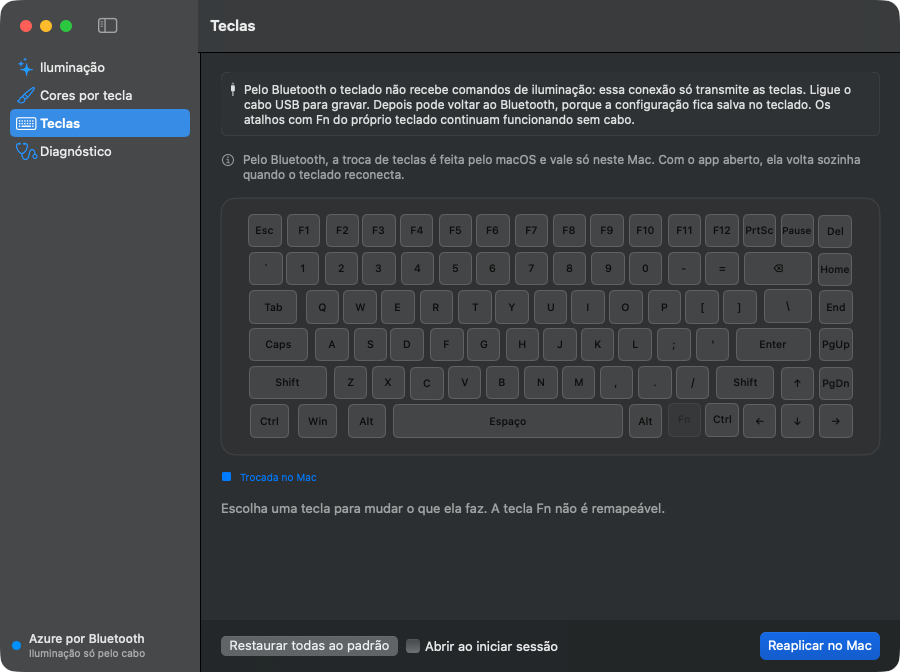

# Teclado K652 para macOS

[](https://github.com/samuelpjacobsen/redragon-k652-macos/actions/workflows/ci.yml)


[](LICENSE)

App nativo para macOS que configura a iluminação RGB e as teclas do **Redragon K652**. Foi testado no Azure (K652GG-RGB-PRO). O driver oficial só existe para Windows; o protocolo foi levantado por engenharia reversa desse driver e está documentado byte a byte em [docs/PROTOCOLO.md](docs/PROTOCOLO.md).

> **English:** native macOS app (SwiftUI + IOKit HID) that configures RGB lighting and key mapping on the Redragon K652 keyboard, with no kernel extension or driver. The protocol was reverse-engineered from the official Windows driver; `docs/PROTOCOLO.md` cites the driver function behind every byte. The UI and docs are in Portuguese.



## O que faz

- **Cores por tecla**: pinte as 84 teclas clicando ou arrastando, em 5 grupos. A pré-visualização ao vivo acende as cores no teclado enquanto você pinta, sem gravar. "Gravar e ativar" salva o grupo no teclado.
- **Iluminação**: os 21 efeitos do driver original, com brilho, velocidade, direção, cores aleatórias e a paleta de 7 cores de cada efeito. Veja [Problemas conhecidos](#problemas-conhecidos).
- **Teclas**: troque o que cada tecla faz. Pelo cabo, a troca vai para a memória do teclado e pode incluir Ctrl, Shift, Alt e Win, mídia ou desativar a tecla. Pelo Bluetooth, quem faz a troca é o macOS.
- **Diagnóstico**: interfaces HID, firmware, identificação e o bloco de iluminação em hexadecimal.
- **`k652ctl`**: linha de comando para ler, gravar e testar o protocolo.

| Iluminação | Teclas |
|---|---|
|  |  |

## Compatibilidade

| Teclado | Conexão | O que funciona |
|---|---|---|
| Redragon Azure (K652GG-RGB-PRO), firmware `0x0104` | cabo USB | cores por tecla, leitura e gravação do bloco de iluminação, quadro ao vivo |
| o mesmo | Bluetooth (`000E:3412`) | remapeamento de teclas pelo macOS. A conexão não tem canal de configuração |
| o mesmo | receptor 2.4G | não testado. O driver oficial também não o reconhece |

O VID/PID `258A:0049` é da SinoWealth e aparece em outros teclados. O app só grava quando reconhece o K652 (veja [Segurança](#segurança)).

## Instalação

Precisa de macOS 14 ou mais novo e do Command Line Tools (`xcode-select --install`). O Xcode também serve, mas não é obrigatório.

```sh
git clone https://github.com/samuelpjacobsen/redragon-k652-macos.git
cd redragon-k652-macos
./scripts/build-app.sh --install   # gera "Teclado K652.app" e copia para /Applications
```

Pelo cabo, o app precisa da permissão de **Monitoramento de Entrada**. O macOS a exige porque o Azure põe os canais de configuração no mesmo dispositivo USB do teclado. Na primeira vez, o app mostra um aviso com o botão "Abrir Monitoramento de Entrada": ligue "Teclado K652" na lista e reabra o app, se o macOS pedir.

A assinatura é ad-hoc e fica presa ao identificador do app, não ao hash do binário. Assim, a permissão continua valendo depois de recompilar. O identificador padrão é `local.samuel.teclado-k652`. Para usar outro, compile com `BUNDLE_ID=io.github.voce.k652 ./scripts/build-app.sh --install`. Se a chave aparecer ligada sem valer, limpe a permissão com `tccutil reset ListenEvent <identificador>`.

## Uso

1. Ligue o teclado pelo cabo USB para gravar iluminação ou teclas. O que você grava fica na memória do teclado e continua valendo no Bluetooth.
2. O selo no canto inferior esquerdo mostra a conexão: verde pelo cabo, azul pelo Bluetooth.

| | Cabo USB | Bluetooth |
|---|---|---|
| Efeitos, brilho, velocidade, paleta | grava no teclado | não (o teclado não recebe) |
| Cores por tecla e pré-visualização ao vivo | grava no teclado | não |
| Trocar teclas | grava no teclado | feito pelo macOS, só neste Mac |

Pelo Bluetooth, a aba Teclas usa o `hidutil` do próprio macOS, aplicado só a esse teclado. O macOS esquece o remapeamento quando o teclado reconecta, e o app o reaplica enquanto estiver aberto. Para valer também depois de reiniciar, ligue "Abrir ao iniciar sessão" na aba Teclas.

O teclado não devolve a paleta nem as cores por tecla. O app guarda o que você escolheu em `~/Library/Application Support/Teclado K652/estado.json`.

Para abrir direto numa aba: `open -a "Teclado K652" --args --secao Teclas`.

## Linha de comando

O `k652ctl` vem dentro do app. Ele só fala com o teclado se o terminal que o roda tiver a permissão de Monitoramento de Entrada.

```sh
K652="/Applications/Teclado K652.app/Contents/MacOS/k652ctl"
"$K652" info                 # identificação, firmware e modo atual
"$K652" fill FFFFFF 5        # todas as teclas brancas, no grupo personalizado 5
"$K652" live 00AAFF 5        # azul ao vivo por 5 s, sem gravar
"$K652" mode 3 4 2           # efeito 3 (Arco-íris), brilho 4, velocidade 2
"$K652" dump-light           # bloco de iluminação em hexadecimal
"$K652" dump 88 B8           # leitura crua de um comando 0x81...0x8F
```

Rode `"$K652"` sem argumentos para ver todos os comandos.

## Segurança

O OpenRGB desativou o controlador SinoWealth depois de relatos de teclados K617, do mesmo VID/PID, que pararam de responder após uma gravação no formato errado. Por isso o app só grava quando as duas condições abaixo valem:

- a identificação (comando `0x81`) não contradiz o PSD do K652 (`02 00 00 00 01 AB`);
- o bloco de iluminação lido tem a assinatura `5A A5` que o driver original grava.

Se alguma falhar, os botões de gravar ficam desativados e a aba Diagnóstico explica o motivo. Dá para liberar lá ou com `--force` no `k652ctl`, mas faça isso só se o teclado for mesmo um K652. Toda gravação lê o bloco atual, troca só os campos conhecidos e devolve o resto como veio.

## Problemas conhecidos

- **Efeitos de hardware apagam o Azure.** No firmware `0x0104`, o Fixo deixou o teclado inteiro apagado, mesmo com os bytes e a paleta confirmados na releitura e iguais aos que o driver oficial grava. A investigação está em [docs/PROTOCOLO.md](docs/PROTOCOLO.md#problema-aberto-efeitos-que-apagam-o-teclado). Para cor estática, use **Cores por tecla** com "Preencher tudo" ou `k652ctl fill`, que funciona.
- Depois de algumas gravações, o teclado sai do USB por um instante e volta. O app reabre a conexão sozinho.
- O app não percebe uma gravação feita pelo `k652ctl`. Ela só aparece depois de reabrir o app.
- Pelo cabo, as teclas com função Fn (F1–F12, 1–4, setas, Esc, Win, espaço e outras) ficam travadas na aba Teclas: trocar apagaria a função Fn.
- Ainda não testados no teclado: gravar a matriz de teclas pelo cabo e o sentido da velocidade (0 pode ser a mais rápida).
- Macros, que o driver grava em `0xDC`–`0xE8`, não são suportadas.

## Como funciona

O teclado fala por *feature reports* HID na página vendor `0xFF00`:

- o report 5 manda comandos;
- o report 6 leva blocos de 1 KB para ler e gravar a flash;
- o report 8 recebe quadros de cor ao vivo.

No Mac, tudo passa pelo IOKit (`IOHIDDeviceSetReport` e `IOHIDDeviceGetReport`), sem driver nem extensão de kernel.

O protocolo saiu do `KeyboardDrv.exe` do instalador oficial V1.6.6. O executável foi extraído com `innoextract` e decompilado com [REA](https://github.com/morluto/rea) sobre o Ghidra. Cada byte em [docs/PROTOCOLO.md](docs/PROTOCOLO.md) cita a função do driver de onde veio, e o documento separa o que já foi conferido no teclado do que não foi.

```
Sources/
  K652Kit/          biblioteca: protocolo e formatos
    Transport/      IOKit HID, leitura do descritor, aviso de conexão
    Protocol/       comandos, K652Device, diagnóstico
    Lighting/       bloco de iluminação, paleta, cores por tecla, quadro ao vivo
    Keys/           ações, matriz de teclas, layout das 84 teclas, remapeamento do Bluetooth
  K652App/          interface em SwiftUI (App, Model, Views, Support)
  k652ctl/          linha de comando
Tests/K652KitTests/ codificadores de bloco, com respostas reais do Azure
```

## Desenvolvimento

```sh
swift build
swift test   # com só o Command Line Tools, veja o CONTRIBUTING.md
```

Contribuições são bem-vindas, principalmente relatos de outros modelos e firmwares. O [CONTRIBUTING.md](CONTRIBUTING.md) explica como compilar, testar e mandar um diagnóstico do seu teclado.

## Aviso

Projeto independente, sem vínculo com a Redragon nem com a SinoWealth. Os nomes e as marcas pertencem aos seus donos. O repositório não inclui o driver, nem código ou arquivos dele: só a descrição do protocolo e os dados de layout necessários para interoperar.

Use por sua conta e risco. Uma gravação no formato errado pode deixar um teclado sem resposta, e é por isso que existem as travas descritas em [Segurança](#segurança).

## Licença

[MIT](LICENSE)
